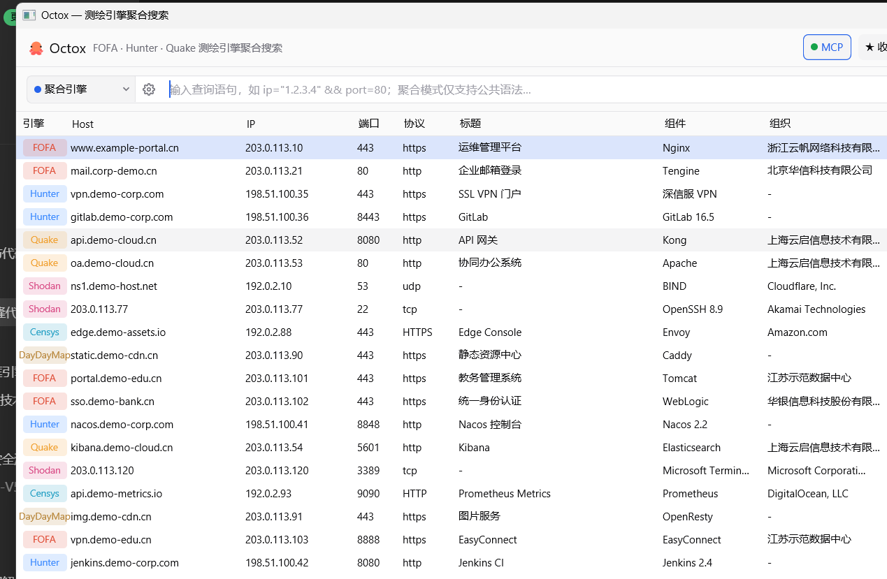

<div align="center">

# 🐙 Octox

**一个窗口，十个测绘引擎。**

FOFA · Hunter · Quake · Shodan · ZoomEye · ThreatBook · 0.zone · DayDayMap · VirusTotal · Censys

[](https://github.com/youmulijiang/octox/actions/workflows/ci.yml)
[](https://github.com/youmulijiang/octox/actions/workflows/release.yml)


*用 Rust + [GPUI](https://crates.io/crates/gpui) 构建的网络空间测绘聚合搜索桌面客户端*

</div>

---

## ✨ 截图

| 深色（默认，shadcn zinc dark） | 浅色（shadcn zinc light） |
| --- | --- |
|  |  |

> 截图为 `--demo` 演示模式（示例数据，不消耗任何平台配额）。

## 🚀 快速开始

### 下载安装

到 [Releases](https://github.com/youmulijiang/octox/releases) 下载对应平台的压缩包解压即用（Windows 为免安装 exe）。

### 从源码构建

```powershell
git clone https://github.com/youmulijiang/octox.git
cd octox
cargo build --release
cargo run
```

> 依赖 Rust 1.85+；Windows 使用 MSVC 工具链，Linux 需安装 X11/Wayland/fontconfig 开发库。

### 配置凭证

首次运行后点击右上角 **⚙ 设置**（或引擎旁的 ⚙ 抽屉）填写凭证，保存于 `%APPDATA%\octox\config.json`：

| 引擎 | 凭证 | 获取位置 |
|---|---|---|
| FOFA | email + key | fofa.info 个人中心 |
| Hunter 鹰图 | api-key | hunter.qianxin.com 个人中心 |
| Quake 360 | X-QuakeToken | quake.360.net 个人中心 |
| Shodan | api-key | shodan.io/account |
| ZoomEye | API-KEY | zoomeye.org 个人信息 |
| ThreatBook | apikey | x.threatbook.com |
| 0.zone | key | 0.zone/apply |
| DayDayMap | api-key | 个人中心 |
| VirusTotal | x-apikey | virustotal.com（结构化搜索需 Intelligence 订阅） |
| Censys | api-id + api-secret | search.censys.io/account |

## 💡 核心特性

- **聚合搜索**：一次查询并发请求多个引擎，统一资产模型展示、分页与导出（CSV/JSON）
  - 单引擎模式使用其**原生语法**（规则面板内置各引擎语法速查）
  - 聚合模式使用**公共语法**（21 个公共字段），自动翻译为各引擎方言
- **引擎个性化配置**：⚙ 右侧滑入抽屉（苹果风格动效）——凭证、聚合参与、
  FOFA 全量数据（F 点）开关、扩展字段勾选（省份/ASN/favicon 等按需显示）、一键测试连接
- **智能表格**：单元格按像素预算截断不溢出、窗口变窄自动收纳次要列、表头与内容同步横向滚动、
  多选复制（Ctrl/Shift+点击，TSV/JSON）、右键复制 Host 头 / URL / 浏览器打开、展开完整详情（点击字段复制）
- **小工具**：🧰 顶部菜单弹层——Favicon Hash 计算（抓取站点图标 → base64 → mmh3，
  与 FOFA `icon_hash` / Shodan `http.favicon.hash` 同款算法，一键复制 hash / FOFA / Shodan 查询语句）、
  URL 解析 HTTP Host 头并复制
- **收藏夹**：查询语句附标签与描述，按标签过滤、一键回填
- **MCP Server**：`octox --mcp`（stdio）或 GUI 内开关（TCP 127.0.0.1:7737），
  Claude / Zed 等 MCP 客户端可直接调用搜索与收藏
- **双主题**：shadcn 配色体系的深/浅主题即时切换；搜索参数（每页条数/翻页上限/
  请求间隔/超时/代理）自由输入

<details>
<summary>📷 更多界面（点开查看）</summary>

⚙ 设置面板（五个 Tab：凭证 / 搜索 / 显示 / 外观 / MCP）与引擎配置抽屉：

- 账户凭证：十引擎凭证，一键保存
- 搜索：每页条数、最大翻页数、请求间隔（错峰规避限频）、超时、HTTP 代理
- 显示：结果表 10 列按需开关
- 外观：深 / 浅主题
- MCP 接入：客户端配置示例与一键复制

</details>

## 查询与分页说明

- 每次查询的请求条数固定，不随窗口高度变化。Shodan 固定每页 100 条，ZoomEye 固定每页 20 条；其他引擎按配置请求。
- 同一查询翻回已加载页使用内存缓存；点击搜索或回车会重新查询。修改查询、引擎或搜索参数后回到第一页。
- 聚合模式始终使用公共语法，即使只勾选一个引擎。各引擎独立判断是否还有下一页，已耗尽的引擎不再重复请求。
- 停止或重新搜索会取消尚未发送的旧请求，并忽略旧结果。已经发出的 HTTP 请求可能继续由平台处理，无法撤销配额消耗。
- “展开引擎状态”可查看各引擎结果和完整错误；“重试失败”保留成功页缓存，仅重新请求未成功的引擎。
- VirusTotal 与 Censys 使用平台返回的游标。MCP `search` 返回各引擎的 `next_cursor`、`has_more`、`page_size`；请求下一页时，保持查询和 size 不变，并传入 `cursors`，例如 `{"virustotal":"上一页返回的游标"}`。不提供游标的后续页会明确报错，不回放前页消耗配额。
- Censys 当前适配 **Legacy Search v2**（API ID / Secret），并保留每台主机的全部服务；平台返回的主机总数与展开后的服务行数可能不同。新 Platform API 的凭证和查询语法不同，不能混用。

## ⌨️ 快捷键

| 按键 | 作用 |
|---|---|
| `Enter` | 搜索 / 接受补全 |
| `↑` / `↓` / `Tab` | 补全项选择与接受 |
| `Ctrl`+点击 / `Shift`+点击 | 表格多选 / 范围选择 |
| 右键 | 行上下文菜单（复制 / 打开 URL / 全选） |
| `Esc` | 关闭弹层 |

## 🛠️ 命令行

```powershell
octox            # 打开 GUI
octox --mcp      # MCP stdio Server（供 MCP 客户端拉起）
octox --demo     # 演示模式（示例数据，无凭证可体验）
octox --smoke    # 自检：开窗 3 秒自动退出
```

## 📁 项目结构

```
src/
├── main.rs           启动、快捷键、--smoke / --mcp / --demo 分流
├── app.rs            根视图编排：布局、搜索、设置 Tabs、收藏夹、抽屉、通知
├── mcp.rs            MCP stdio/TCP Server（JSON-RPC 2.0）
├── translate.rs      公共语法解析与各引擎方言翻译（纯逻辑 + 单测）
├── autocomplete.rs   查询语句自动补全（纯逻辑 + 单测）
├── asset.rs          统一资产模型 + Engine 枚举（10 引擎）
├── config.rs         配置持久化（凭证 / 收藏 / 外观 / 列显示）
├── engines/          10 个引擎模块（请求构建 + 解析 + fixture 单测）
├── export.rs         CSV(BOM) / JSON 导出
└── ui/               GPUI 组件：输入框 / 下拉框 / 弹层 / 主题 / 图标
```

## ⚠️ 合规声明

仅使用你自己合法注册的平台 API Key，遵守各平台服务条款与配额；
数据仅用于授权范围内的安全研究与资产梳理。

## License

[MIT](LICENSE)
